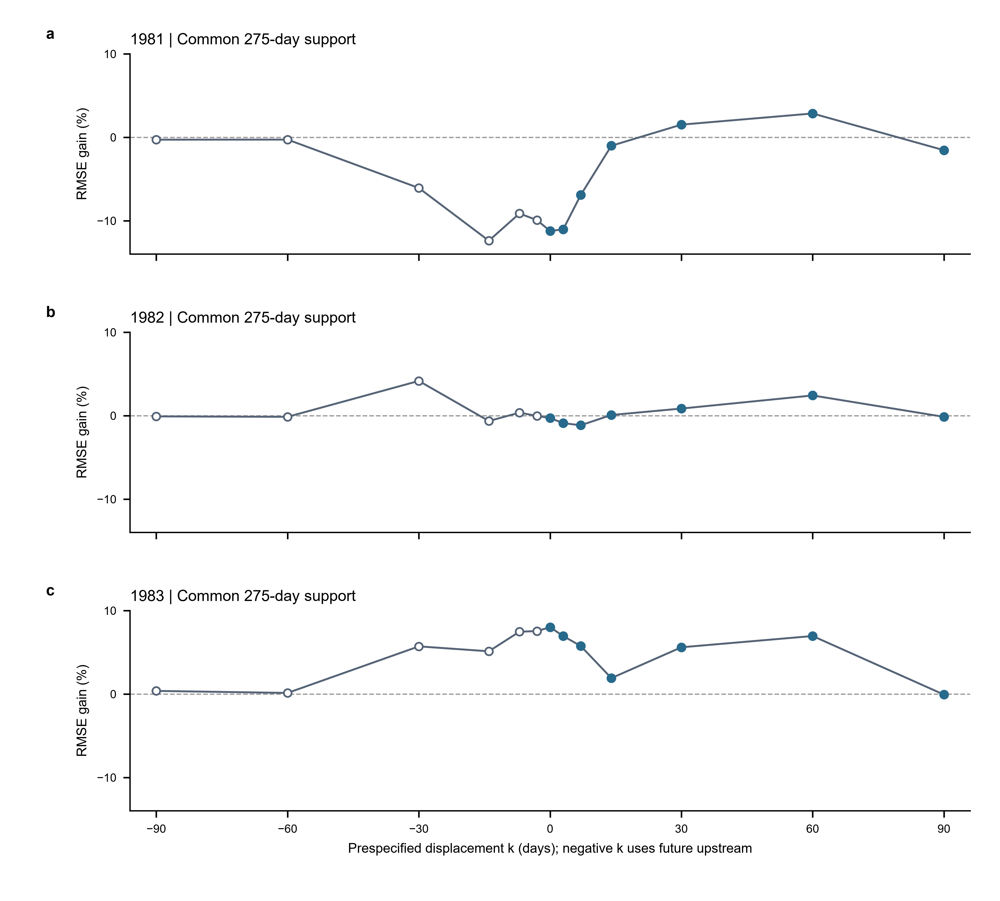

# VHS-NEXT-S1A-R1｜真实回顾性增量信息评价

身份：PRE_SPECIFIED_POST_EXPOSURE_DEVELOPMENT_ANALYSIS。全部年份曾被历史研究接触；STRICT_ZERO_SHOT=false，INDEPENDENT_FINAL_TEST=false，CAUSAL_TRANSPORT_IDENTIFIED=false。单位仅为项目Q数值单位；日均/原始单位/水文日界/发布时刻/供数方未证实，不换算物理m³。

**主实验未通过预定实践规则。** Past-only两年退化、一年改善，宏平均为负，30/60日原始条件CI均跨0；不据此证明所有上游信息或非线性方法无效。

## 1. Past-only主结果与完整支持

- 1981：RMSE 45.034632 → 49.757510；增益 -10.487%；DeltaNSE -0.113004。
- 1982：RMSE 48.984215 → 49.028888；增益 -0.091%；DeltaNSE -0.001535。
- 1983：RMSE 42.749118 → 39.295324；增益 +8.079%；DeltaNSE +0.087094。

三年等权宏平均相对RMSE增益 **-0.833%**。每折真实支持365日；train=1066/1431/1796日，从1978-01-31开始。

全部指标的等权年度宏平均见s1a_r1_macro_metrics.csv；pooled辅助见s1a_r1_pooled_auxiliary.csv。pooled仅描述性合并，不把日样本当独立重复，也不跨年拼接bootstrap；它不替代预定宏平均判定。

原始规则依次为：三年均改善 **FAIL**；宏平均≥2% **FAIL**；30/60日circular条件95%CI下界>0 **FAIL**；PBIAS/低流代价门槛 **无越界**。综合MIXED_OR_UNCERTAIN，MAIN_DEVELOPMENT_GAIN_SUPPORTED=false；不能用1983单年或Same-day替代主结论。

## 2. Same-day次要制度

- 1981：RMSE 45.034632 → 49.599577；增益 -10.137%；DeltaNSE -0.109043。
- 1982：RMSE 48.984215 → 48.949965；增益 +0.070%；DeltaNSE +0.001176。
- 1983：RMSE 42.749118 → 39.238210；增益 +8.213%；DeltaNSE +0.088472。

三年等权宏平均 -0.618%，同样不通过稳定实践规则。结果单独分组，不和Past-only混排；真实当天可用性未认证。

## 3. 条件性Bootstrap

每年内部独立配对抽样，10000次、seed20261011、固定30/60日；区间不是未来年份泛化区间，不覆盖训练估计、历史探索或跨年依赖。不报告总体显著性p值。

Past-only三年等权宏平均相对RMSE增益95%CI：

- 原始circular：30日 [-4.493%, +6.145%]；60日 [-4.640%, +10.337%]。
- 非环绕敏感性：30日 [-4.387%, +5.366%]；60日 [-4.301%, +7.944%]。

Same-day三年等权宏平均相对RMSE增益95%CI：

- 原始circular：30日 [-4.224%, +6.482%]；60日 [-4.326%, +10.945%]。
- 非环绕敏感性：30日 [-4.113%, +5.697%]；60日 [-4.044%, +8.477%]。

F2三年等权宏平均相对RMSE增益95%CI：

- 原始circular：30日 [-4.456%, +3.277%]；60日 [-4.680%, +3.125%]。
- 非环绕敏感性：30日 [-4.338%, +3.021%]；60日 [-4.156%, +2.290%]。

非环绕区间也跨0，未改变主不确定性判断；两种方法均完整保留，未选择有利CI。全部16个预定配对对照的逐年及宏平均CI见bootstrap CSV；不同位移的区间不构成独立重复或经校正的显著性检验。

## 4. 固定F2平滑季节敏感性

- 1981：RMSE 41.811572 → 45.427988；增益 -8.649%；DeltaNSE -0.079636。
- 1982：RMSE 47.057609 → 47.480510；增益 -0.899%；DeltaNSE -0.014017。
- 1983：RMSE 43.518066 → 40.625834；增益 +6.646%；DeltaNSE +0.074799。

F2-only相对F2+同一monthly上游异常，宏平均 -0.967%。仍为两年退化、一年改善；1981低流RMSE恶化 +27.362%，超过5%门槛，NOT_ROBUST_USEFULNESS。没有复用Fourier6系数或搜索谐波。该敏感性不支持稳定增量，也不能单独判定月阶梯不足是唯一原因。

## 5. 时间错位Placebo

所有k在共同train=886/1251/1616日拟合beta，在共同开发Jan1..Oct2共275日评分；目标月气候态及源月份统计仍用原完整合法train。k=0也重新拟合、同掩码评分。下列数值不能与主365日结果直接比较。负k为非因果未来上游诊断。

- k=-90：1981 -0.277%；1982 -0.081%；1983 +0.378%；等权宏平均 +0.007%。
- k=-60：1981 -0.267%；1982 -0.133%；1983 +0.136%；等权宏平均 -0.088%。
- k=-30：1981 -6.067%；1982 +4.168%；1983 +5.717%；等权宏平均 +1.272%。
- k=-14：1981 -12.387%；1982 -0.636%；1983 +5.127%；等权宏平均 -2.632%。
- k=-7：1981 -9.122%；1982 +0.368%；1983 +7.475%；等权宏平均 -0.427%。
- k=-3：1981 -9.919%；1982 -0.025%；1983 +7.549%；等权宏平均 -0.799%。
- k=+0：1981 -11.225%；1982 -0.282%；1983 +8.014%；等权宏平均 -1.164%。
- k=+3：1981 -11.018%；1982 -0.890%；1983 +6.953%；等权宏平均 -1.652%。
- k=+7：1981 -6.907%；1982 -1.145%；1983 +5.761%；等权宏平均 -0.764%。
- k=+14：1981 -1.006%；1982 +0.088%；1983 +1.912%；等权宏平均 +0.331%。
- k=+30：1981 +1.525%；1982 +0.857%；1983 +5.607%；等权宏平均 +2.663%。
- k=+60：1981 +2.862%；1982 +2.428%；1983 +6.957%；等权宏平均 +4.082%。
- k=+90：1981 -1.538%；1982 -0.135%；1983 -0.065%；等权宏平均 -0.580%。

真实对齐k=0分别为−11.225%、−0.282%、+8.014%，宏平均−1.164%。固定+30及+60日均在三年保留正点估计增益；其中+60为+2.862%、+2.428%、+6.957%，宏平均+4.082%。这些是固定网格的描述结果，不是新lag选择、不视为最佳传播时间，也不将2%主阈值移作placebo显著性标准。

1981：near均值−far均值=-9.833%；far均值=+0.195%；far/aligned=NA（aligned≤0）。

1982：near均值−far均值=-0.914%；far均值=+0.520%；far/aligned=NA（aligned≤0）。

1983：near均值−far均值=+5.299%；far均值=+1.852%；far/aligned=0.231。

near固定{-7,-3,0,3,7}，far固定{-90,-60,60,90}。正负不对称逐对数字及g(0)-各far见placebo_response_summary.json。1983有局部近零改善，但1981/1982不复现，且远错位仍保留能力；没有跨年一致的真实对齐优势，L2_NOT_ESTABLISHED。共同天气、残留季节、慢变状态和自相关未排除。

图中各点为预定13个位移的逐年点估计，均为275日支持；空心点为未来上游诊断，实心点为k≥0。连线仅引导读图，不插值选择lag；不展示CI，条件CI在CSV。

## 6. 共线性与系数

- 1981：标准化beta=(5.315523, 15.314862, 3.414269)；条件数=3.956206；VIF=[2.8614532686776566, 4.18210123916111, 2.123520572467059]。
- 1982：标准化beta=(5.475906, 8.758414, 4.642838)；条件数=3.960703；VIF=[2.953551929218184, 4.185986482329752, 1.9838595821167364]。
- 1983：标准化beta=(6.363782, 6.377196, 4.312923)；条件数=3.923188；VIF=[2.888709566749954, 4.128293478347159, 1.9769962116716924]。

三列满秩，未触发尺度或秩停止条件；三折beta全为正，但7日系数明显变化。标准差随折变化，标准化系数大小不能直接当固定物理效应；相关/SVD/VIF和所有对照系数完整保留，未删窗或加入ridge。

## 7. 最差年份、洪峰与低流

- 1981：低流RMSE 6.738281 → 5.347663（-20.638%）；洪峰日期误差 +34 → +55日；峰值误差 -36.086022 → -18.629482；绝对PBIAS变化 -1.397967个百分点。
- 1982：低流RMSE 7.849006 → 6.575758（-16.222%）；洪峰日期误差 -36 → -27日；峰值误差 -94.862903 → -85.605796；绝对PBIAS变化 -1.899764个百分点。
- 1983：低流RMSE 7.402653 → 5.536111（-25.214%）；洪峰日期误差 -44 → -16日；峰值误差 -65.967742 → -62.215802；绝对PBIAS变化 -5.528710个百分点。

最差增益年1981：RMSE恶化10.487%，峰日由晚34日恶化至晚55日，虽低流与总量偏差改善也不能掩盖整体失败。1982仍严重低估洪峰，1983峰日与RMSE改善但峰值明显偏低。主模型三年均无非负裁剪；F2/所有placebo的裁剪及月偏差完整列入CSV。洪峰只为日期索引/数值诊断，不是实测传播时滞。

## 8. 证据边界与下一轮竞争解释

没有获得跨三年稳定的L1增量证据；1983单年呈现条件开发改善，不能升格为总体稳定L1。L2未建立，L3/L4不能确认。TRANSPORT_INTERPRETATION_NOT_ESTABLISHED。负结果不证明上游没有任何信息，也不证明更复杂方法有效。

下一轮最值得审查的单个竞争解释：**上游异常主要是慢变水文状态代理，而非可跨年稳定复现的日级同步信息**。远错位保留增益、年度方向分化与系数变化与此相容，但本轮没有识别其原因。未来必须另行授权并冻结检验，不据本轮曲线优化lag或立即开启新模型。

## 9. 完整性与可复现交付

150个定向历史保护文件及已封存预测/参数/config哈希无变化。原始数据、E4/E5、论文、S0/S0.1/R0均未修改；无GPU、E5I1、Own-Past、R1/R2/Fourier6重拟合或未授权搜索。48个固定对照拟合，14010行预测，48组指标，256行bootstrap区间；全部预测先于开发标签评分封存。

[执行清单](../experiments/s1a_r1/s1a_r1_execution_manifest.json)、[预测封存](../experiments/s1a_r1/prediction_freeze.json)、[逐次事件](../experiments/s1a_r1/execution_events.jsonl)、[完整数据角色台账](../experiments/s1a_r1/data_role_ledger.json)、[主指标](../experiments/s1a_r1/s1a_r1_fold_metrics.csv)、[Bootstrap](../experiments/s1a_r1/s1a_r1_bootstrap_summary.csv)、[完整性](../experiments/s1a_r1/s1a_r1_integrity_report.json)。

本阶段完成后停止，等待新的用户批准。
