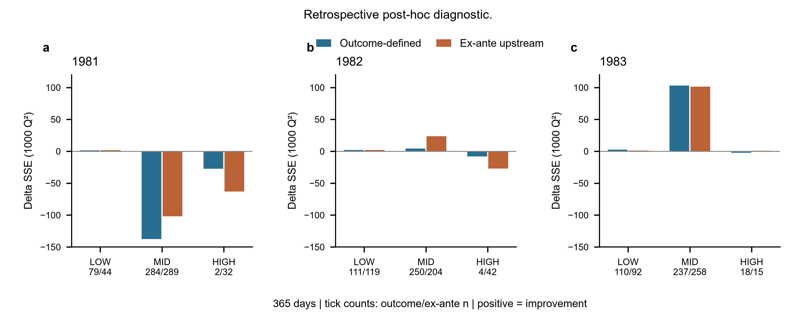
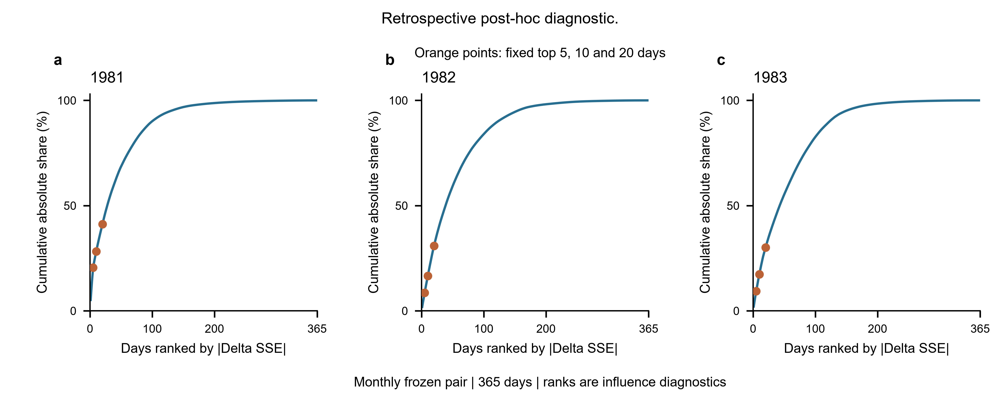
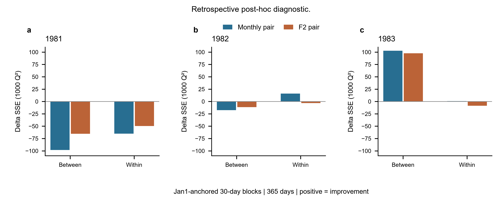
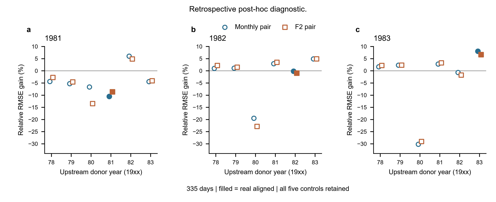
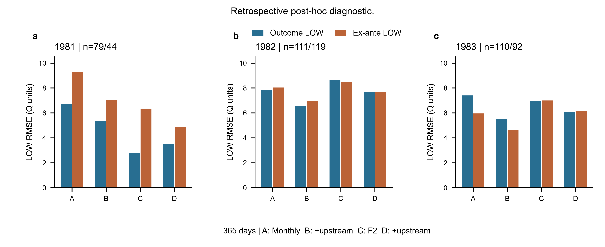

# VHS-NEXT-S1A-R2｜冻结预测误差结构与年份交换反证

身份：**POST_HOC_EXPLORATORY_DIAGNOSTIC**。全部结果为历史已暴露数据上的回顾性事后诊断，不是独立测试、确认性检验或因果证据。单位沿用项目 Q 数值单位，SSE 为 Q²；单位、日界与供数时刻未认证。

R1 主结论保持：1981/1982/1983 相对 RMSE 增益 −10.487%/−0.091%/+8.079%，三年等权宏平均 −0.833%，预定主实践标准未通过。R2 没有重新拟合、搜索或重新 bootstrap。

## 1. 1981 全年恶化由哪些日期与区间主导？

- Outcome LOW：n=79，DeltaSSE=1327.75，RMSE 6.74→5.35。
- Outcome MID：n=284，DeltaSSE=-137498.89，RMSE 48.45→53.21。
- Outcome HIGH：n=2，DeltaSSE=-27236.32，RMSE 187.23→220.62。

全年 DeltaSSE=−163407.47。MID 贡献 −137498.89，HIGH 仅2日贡献 −27236.32；训练 Q90 的 HIGH 与日常语言的所有洪水事件并不等同。不能把恶化全部归给极少数 HIGH 日。绝对贡献最大的前5日恰为 5月27–31日，共 −59500.51；前20日净贡献 −119440.45，覆盖总 |DeltaSSE| 的41.23%。

- 1981-05-28：outcome=HIGH，ex-ante=MID，DeltaSSE=-14921.67。
- 1981-05-27：outcome=HIGH，ex-ante=MID，DeltaSSE=-12314.65。
- 1981-05-29：outcome=MID，ex-ante=MID，DeltaSSE=-12208.51。
- 1981-05-31：outcome=MID，ex-ante=MID，DeltaSSE=-10334.31。
- 1981-05-30：outcome=MID，ex-ante=MID，DeltaSSE=-9721.37。
- 1981-05-26：outcome=MID，ex-ante=MID，DeltaSSE=-4976.30。
- 1981-07-23：outcome=MID，ex-ante=HIGH，DeltaSSE=-4611.06。
- 1981-07-22：outcome=MID，ex-ante=HIGH，DeltaSSE=-4316.73。
- 1981-06-03：outcome=MID，ex-ante=MID，DeltaSSE=-4293.65。
- 1981-08-07：outcome=MID，ex-ante=HIGH，DeltaSSE=-4123.24。

完整前20日、正负总贡献、前5/10/20集中度和全部块删除诊断保存在 influence.csv。N_eff 是贡献集中度，不是独立样本数。

- 1981：正贡献 63132.60，负贡献 -226540.07，N_eff=65.79；删除固定30日块导致年度符号改变 0/13。
- 1982：正贡献 78039.94，负贡献 -79638.12，N_eff=109.49；删除固定30日块导致年度符号改变 3/13。
  删除 1982-05-31–1982-06-29 后剩余 DeltaSSE=22732.52；仅为影响诊断，不更新正式结果。
  删除 1982-07-30–1982-08-28 后剩余 DeltaSSE=656.21；仅为影响诊断，不更新正式结果。
  删除 1982-08-29–1982-09-27 后剩余 DeltaSSE=6699.00；仅为影响诊断，不更新正式结果。
- 1983：正贡献 118668.41，负贡献 -15240.34，N_eff=114.44；删除固定30日块导致年度符号改变 0/13。

## 2. 低流改善是绝对下降还是分母效应？

- 1981 past_only outcome LOW n=79：RMSE 6.7383→5.3477，绝对变化 -1.3906；DeltaSSE=1327.75；MSE差=16.8069，偏差平方贡献=-3.1964，组内方差贡献=20.0033。
- 1981 f2 outcome LOW n=79：RMSE 2.7683→3.5258，绝对变化 +0.7575；DeltaSSE=-376.64；MSE差=-4.7676，偏差平方贡献=-3.1508，组内方差贡献=-1.6167。
- 1982 past_only outcome LOW n=111：RMSE 7.8490→6.5758，绝对变化 -1.2732；DeltaSSE=2038.66；MSE差=18.3663，偏差平方贡献=16.6777，组内方差贡献=1.6886。
- 1982 f2 outcome LOW n=111：RMSE 8.6673→7.6900，绝对变化 -0.9773；DeltaSSE=1774.45；MSE差=15.9860，偏差平方贡献=19.9375，组内方差贡献=-3.9515。
- 1983 past_only outcome LOW n=110：RMSE 7.4027→5.5361，绝对变化 -1.8665；DeltaSSE=2656.58；MSE差=24.1507，偏差平方贡献=17.8915，组内方差贡献=6.2593。
- 1983 f2 outcome LOW n=110：RMSE 6.9563→6.0855，绝对变化 -0.8708；DeltaSSE=1249.20；MSE差=11.3564，偏差平方贡献=17.1635，组内方差贡献=-5.8071。

Monthly 低流误差确实绝对下降，不只是百分比分母造成：三年 RMSE 减少约1.39/1.27/1.87。1981 F2-only 低流 RMSE 已为2.7683，远低于 Monthly-only 的6.7383；F2+upstream 为3.5258，虽绝对上低于 Monthly+upstream 的5.3477，却相对其自身对照恶化27.36%。必须区分基线之间的绝对水平与各自上游增量。1981 Monthly LOW 均值偏差反而由2.0180升至2.6961，改善来自组内误差方差减少；F2 LOW 的偏差平方和方差均恶化。1982/1983 的低流改善较多来自偏差项，不能统一解释为传播。

## 3. 事前分层是否支持同样的低流改善？

- 1981 past_only 已知上游 LOW：n=44，RMSE 9.2712→7.0259，增益 +24.22%，DeltaSSE=1610.01。
- 1981 f2 已知上游 LOW：n=44，RMSE 6.3503→4.8581，增益 +23.50%，DeltaSSE=735.91。
- 1982 past_only 已知上游 LOW：n=119，RMSE 8.0368→6.9754，增益 +13.21%，DeltaSSE=1896.15。
- 1982 f2 已知上游 LOW：n=119，RMSE 8.5031→7.6743，增益 +9.75%，DeltaSSE=1595.54。
- 1983 past_only 已知上游 LOW：n=92，RMSE 5.9528→4.6239，增益 +22.32%，DeltaSSE=1293.03。
- 1983 f2 已知上游 LOW：n=92，RMSE 6.9936→6.1530，增益 +12.02%，DeltaSSE=1016.77。

两种基线下三年事前上游 LOW 均改善。因此不能将总体低状态改善判定为只有 outcome 条件选择才出现；OUTCOME_CONDITIONING_SENSITIVE 的整体现象触发条件不成立。但1981 outcome LOW 在F2下恶化、ex-ante LOW却改善，说明具体标签和基线确实影响结论。事前 LOW 是已知上游状态，绝非下游真实低流量分类。

- 1981：两种 LOW 交集 26 日，outcome/ex-ante分别 79/44 日，Jaccard=0.268。
- 1982：两种 LOW 交集 104 日，outcome/ex-ante分别 111/119 日，Jaccard=0.825。
- 1983：两种 LOW 交集 86 日，outcome/ex-ante分别 110/92 日，Jaccard=0.741。

## 4. 四格基线与月份、月内相位

四格冻结预测在每种分层内使用相同日期。A/B为Monthly-only/+upstream，C/D为F2-only/+upstream；详见 four_cell_baselines.csv（绝对 RMSE/MAE/Bias/SSE 和两组配对 DeltaSSE）。1981 outcome LOW 的增量方向随季节表示翻转，支持“增益依赖季节表示”，但F2仍未修复年度稳定性，也不能证明Monthly季节不足是唯一原因。

以下为 outcome LOW 各月 n、Monthly/F2 DeltaSSE（全部空格及小样本格保留在 monthly_strata.csv；n<10只作不稳定描述）。
- 1981：01月 n=4, Δ=-150.49/-162.47；02月 n=13, Δ=195.46/-242.94；03月 n=21, Δ=324.98/-273.80；04月 n=0, Δ=NA/NA；05月 n=0, Δ=NA/NA；06月 n=0, Δ=NA/NA；07月 n=0, Δ=NA/NA；08月 n=0, Δ=NA/NA；09月 n=0, Δ=NA/NA；10月 n=0, Δ=NA/NA；11月 n=10, Δ=677.94/4.51；12月 n=31, Δ=279.85/298.07。
- 1982：01月 n=31, Δ=1762.88/1377.61；02月 n=28, Δ=13.44/36.50；03月 n=30, Δ=115.84/206.75；04月 n=0, Δ=NA/NA；05月 n=0, Δ=NA/NA；06月 n=0, Δ=NA/NA；07月 n=0, Δ=NA/NA；08月 n=0, Δ=NA/NA；09月 n=0, Δ=NA/NA；10月 n=0, Δ=NA/NA；11月 n=4, Δ=198.54/-43.47；12月 n=18, Δ=-52.04/197.05。
- 1983：01月 n=31, Δ=492.78/356.02；02月 n=28, Δ=233.93/306.74；03月 n=18, Δ=53.99/-58.24；04月 n=0, Δ=NA/NA；05月 n=0, Δ=NA/NA；06月 n=0, Δ=NA/NA；07月 n=0, Δ=NA/NA；08月 n=0, Δ=NA/NA；09月 n=0, Δ=NA/NA；10月 n=0, Δ=NA/NA；11月 n=12, Δ=1357.57/164.34；12月 n=21, Δ=518.31/480.35。

固定月内01–15/16–月底的 LOW 组成、偏差、方差及绝对误差另见 low_flow_month_phase.csv。未按结果寻找分割点、调整季节谐波或改变评价样本。月份与低流状态重叠，不是两条独立证据。

- 1981 past_only 01月 day01_15：n=4，RMSE 1.756→6.380，Bias 1.363→6.297，DeltaSSE=-150.49。
- 1981 past_only 02月 day01_15：n=1，RMSE 6.169→2.444，Bias -6.169→-2.444，DeltaSSE=32.09。
- 1981 past_only 02月 day16_end：n=12，RMSE 4.001→1.548，Bias -3.761→0.434，DeltaSSE=163.37。
- 1981 past_only 03月 day01_15：n=15，RMSE 4.196→1.634，Bias -4.165→-1.528，DeltaSSE=224.02。
- 1981 past_only 03月 day16_end：n=6，RMSE 4.424→1.656，Bias -4.405→-1.573，DeltaSSE=100.96。
- 1981 past_only 11月 day16_end：n=10，RMSE 15.044→12.590，Bias 14.956→12.541，DeltaSSE=677.94。
- 1981 past_only 12月 day01_15：n=15，RMSE 4.128→4.962，Bias 4.121→4.950，DeltaSSE=-113.74。
- 1981 past_only 12月 day16_end：n=16，RMSE 5.269→1.777，Bias 5.176→1.109，DeltaSSE=393.59。
- 1981 f2 01月 day01_15：n=4，RMSE 2.724→6.931，Bias 2.429→6.833，DeltaSSE=-162.47。
- 1981 f2 02月 day01_15：n=1，RMSE 0.604→2.816，Bias -0.604→2.816，DeltaSSE=-7.57。
- 1981 f2 02月 day16_end：n=12，RMSE 1.229→4.596，Bias 0.689→4.461，DeltaSSE=-235.37。
- 1981 f2 03月 day01_15：n=15，RMSE 0.946→3.199，Bias 0.694→3.153，DeltaSSE=-140.09。
- 1981 f2 03月 day16_end：n=6，RMSE 2.857→5.518，Bias 2.785→5.419，DeltaSSE=-133.70。
- 1981 f2 11月 day16_end：n=10，RMSE 1.606→1.459，Bias 1.227→-1.170，DeltaSSE=4.51。
- 1981 f2 12月 day01_15：n=15，RMSE 1.806→2.650，Bias 1.762→2.646，DeltaSSE=-56.43。
- 1981 f2 12月 day16_end：n=16，RMSE 5.124→2.025，Bias 4.801→1.331，DeltaSSE=354.50。

1981的具体相位线索：2–3月Monthly-only在LOW样本中多为约−4的低估，上游修正可补偿；F2-only在这些样本已接近观测或轻微高估，同方向上游修正转为过估。11月LOW全部位于下半月，Monthly偏差14.956→12.541，而F2偏差1.227→−1.170，其DeltaSSE仅4.51，远小于Monthly的677.94。12月两个半月的增量方向又不同。样本与季节相位重叠可以解释敏感性现象，不能识别季节不足的因果比例。

## 5. 块均值与块内误差哪部分决定全年结果？

- 1981 past_only：between Δ=-98203.38，within Δ=-65204.09，合计 -163407.47。
- 1981 f2：between Δ=-65428.60，within Δ=-49726.90，合计 -115155.50。
- 1982 past_only：between Δ=-17557.93，within Δ=15959.75，合计 -1598.18。
- 1982 f2：between Δ=-11428.46，within Δ=-3164.33，合计 -14592.79。
- 1983 past_only：between Δ=102749.10，within Δ=678.96，合计 103428.07。
- 1983 f2：between Δ=97515.58，within Δ=-8687.84，合计 88827.74。

1981两部分都恶化，块均值损失较大；1982 Monthly的块内改善被块均值恶化抵消；1983 Monthly几乎全部改善来自块均值，F2的块内部分甚至恶化。此正交数学分解不把 between 等同基流，也不把 within 等同真实快速河道传播。

## 6. 年份交换中真实对齐的位置

仅335日 Jan31–Dec31，同一目标季节基线、beta、训练月份均值、尺度和真实日期分层。每年每种基线完整报告五个donor及self。如下相对RMSE增益只在本335日支持比较；排序按 augmented RMSE，1最好；并列按固定数值容差，不构造p值。

- 1981 past_only：真实名次 6/6，5/5 donor超过真实，ties=0；donor增益 min/median/max=-6.667%/-4.436%/+6.025%。
  donor 1978：RMSE 46.9505→49.0052，gain=-4.376%，ΔSSE=-66046.55，between/within Δ=-79076.45/13029.89。
  donor 1979：RMSE 46.9505→49.4243，gain=-5.269%，ΔSSE=-79867.54，between/within Δ=-91119.52/11251.98。
  donor 1980：RMSE 46.9505→50.0806，gain=-6.667%，ΔSSE=-101745.57，between/within Δ=-59901.74/-41843.83。
  donor 1981 self：RMSE 46.9505→51.8943，gain=-10.530%，ΔSSE=-163702.17，between/within Δ=-99012.92/-64689.24。
  donor 1982：RMSE 46.9505→44.1219，gain=+6.025%，ΔSSE=86299.11，between/within Δ=10857.05/75442.06。
  donor 1983：RMSE 46.9505→49.0332，gain=-4.436%，ΔSSE=-66966.55，between/within Δ=-38488.62/-28477.92。
  orthogonal/between 真实名次=6/6；donor胜出=5/5。
  orthogonal/within 真实名次=6/6；donor胜出=5/5。
  outcome/LOW 真实名次=4/6；donor胜出=3/5。
  exante/LOW 真实名次=1/6；donor胜出=0/5。
- 1981 f2：真实名次 5/6，4/5 donor超过真实，ties=0；donor增益 min/median/max=-13.486%/-4.090%/+4.854%。
  donor 1978：RMSE 43.5970→44.8065，gain=-2.774%，ΔSSE=-35821.00，between/within Δ=-22819.05/-13001.96。
  donor 1979：RMSE 43.5970→45.5938，gain=-4.580%，ΔSSE=-59663.63，between/within Δ=-46294.60/-13369.03。
  donor 1980：RMSE 43.5970→49.4762，gain=-13.486%，ΔSSE=-183313.53，between/within Δ=-117353.92/-65959.61。
  donor 1981 self：RMSE 43.5970→47.3797，gain=-8.677%，ΔSSE=-115287.80，between/within Δ=-65963.95/-49323.84。
  donor 1982：RMSE 43.5970→41.4808，gain=+4.854%，ΔSSE=60312.60，between/within Δ=14368.17/45944.43。
  donor 1983：RMSE 43.5970→45.3801，gain=-4.090%，ΔSSE=-53151.26，between/within Δ=-17913.41/-35237.85。
  orthogonal/between 真实名次=5/6；donor胜出=4/5。
  orthogonal/within 真实名次=5/6；donor胜出=4/5。
  outcome/LOW 真实名次=4/6；donor胜出=3/5。
  exante/LOW 真实名次=1/6；donor胜出=0/5。
- 1982 past_only：真实名次 5/6，4/5 donor超过真实，ties=0；donor增益 min/median/max=-19.509%/+1.086%/+4.915%。
  donor 1978：RMSE 51.0196→50.5194，gain=+0.981%，ΔSSE=17016.37，between/within Δ=-18073.21/35089.58。
  donor 1979：RMSE 51.0196→50.4654，gain=+1.086%，ΔSSE=18841.72，between/within Δ=6191.23/12650.49。
  donor 1980：RMSE 51.0196→60.9732，gain=-19.509%，ΔSSE=-373436.52，between/within Δ=-212672.07/-160764.44。
  donor 1981：RMSE 51.0196→49.5363，gain=+2.907%，ΔSSE=49966.22，between/within Δ=34102.67/15863.54。
  donor 1982 self：RMSE 51.0196→51.1152，gain=-0.187%，ΔSSE=-3271.76，between/within Δ=-19210.23/15938.47。
  donor 1983：RMSE 51.0196→48.5119，gain=+4.915%，ΔSSE=83615.28，between/within Δ=60830.39/22784.89。
  orthogonal/between 真实名次=5/6；donor胜出=4/5。
  orthogonal/within 真实名次=3/6；donor胜出=2/5。
  outcome/LOW 真实名次=4/6；donor胜出=3/5。
  exante/LOW 真实名次=4/6；donor胜出=3/5。
- 1982 f2：真实名次 5/6，4/5 donor超过真实，ties=0；donor增益 min/median/max=-22.863%/+2.171%/+4.876%。
  donor 1978：RMSE 49.0264→47.9619，gain=+2.171%，ΔSSE=34587.50，between/within Δ=23357.83/11229.68。
  donor 1979：RMSE 49.0264→48.3076，gain=+1.466%，ΔSSE=23436.39，between/within Δ=30541.33/-7104.94。
  donor 1980：RMSE 49.0264→60.2353，gain=-22.863%，ΔSSE=-410274.57，between/within Δ=-239637.44/-170637.13。
  donor 1981：RMSE 49.0264→47.3230，gain=+3.474%，ΔSSE=54980.16，between/within Δ=40996.81/13983.36。
  donor 1982 self：RMSE 49.0264→49.5083，gain=-0.983%，ΔSSE=-15906.78，between/within Δ=-12734.16/-3172.62。
  donor 1983：RMSE 49.0264→46.6359，gain=+4.876%，ΔSSE=76608.64，between/within Δ=68033.47/8575.17。
  orthogonal/between 真实名次=5/6；donor胜出=4/5。
  orthogonal/within 真实名次=4/6；donor胜出=3/5。
  outcome/LOW 真实名次=2/6；donor胜出=1/5。
  exante/LOW 真实名次=2/6；donor胜出=1/5。
- 1983 past_only：真实名次 1/6，0/5 donor超过真实，ties=0；donor增益 min/median/max=-30.212%/+1.679%/+2.772%。
  donor 1978：RMSE 44.6032→43.8545，gain=+1.679%，ΔSSE=22186.77，between/within Δ=28204.95/-6018.17。
  donor 1979：RMSE 44.6032→43.5771，gain=+2.300%，ΔSSE=30310.07，between/within Δ=50278.47/-19968.40。
  donor 1980：RMSE 44.6032→58.0787，gain=-30.212%，ΔSSE=-463537.01，between/within Δ=-317198.77/-146338.24。
  donor 1981：RMSE 44.6032→43.3667，gain=+2.772%，ΔSSE=36437.99，between/within Δ=57051.80/-20613.81。
  donor 1982：RMSE 44.6032→44.9053，gain=-0.677%，ΔSSE=-9060.42，between/within Δ=-8388.97/-671.46。
  donor 1983 self：RMSE 44.6032→41.0121，gain=+8.051%，ΔSSE=102996.10，between/within Δ=102365.48/630.62。
  orthogonal/between 真实名次=1/6；donor胜出=0/5。
  orthogonal/within 真实名次=1/6；donor胜出=0/5。
  outcome/LOW 真实名次=1/6；donor胜出=0/5。
  exante/LOW 真实名次=1/6；donor胜出=0/5。
- 1983 f2：真实名次 1/6，0/5 donor超过真实，ties=0；donor增益 min/median/max=-29.069%/+2.171%/+3.241%。
  donor 1978：RMSE 45.4109→44.4252，gain=+2.171%，ΔSSE=29663.73，between/within Δ=50847.21/-21183.48。
  donor 1979：RMSE 45.4109→44.3573，gain=+2.320%，ΔSSE=31684.19，between/within Δ=64182.48/-32498.30。
  donor 1980：RMSE 45.4109→58.6112，gain=-29.069%，ΔSSE=-459997.35，between/within Δ=-308551.03/-151446.31。
  donor 1981：RMSE 45.4109→43.9393，gain=+3.241%，ΔSSE=44047.90，between/within Δ=61433.00/-17385.10。
  donor 1982：RMSE 45.4109→46.2214，gain=-1.785%，ΔSSE=-24879.46，between/within Δ=-10297.50/-14581.96。
  donor 1983 self：RMSE 45.4109→42.4018，gain=+6.626%，ΔSSE=88518.26，between/within Δ=97245.62/-8727.36。
  orthogonal/between 真实名次=1/6；donor胜出=0/5。
  orthogonal/within 真实名次=1/6；donor胜出=0/5。
  outcome/LOW 真实名次=1/6；donor胜出=0/5。
  exante/LOW 真实名次=1/6；donor胜出=0/5。

1983真实对齐在两种基线的整体、between、within及事前LOW中均排第一，提供单年年份对应信息的描述性线索；1981/1982不复现。尤其1983相对自身基线的年度改善主要来自between，而真实对齐相对donor的within比较也占优：这两种参照不同，不能混为“块内绝对误差改善很大”。不能据此确认跨年稳定事件同步能力。

## 7. 交换年份是否保留类似低流改善？

- 1981 past_only outcome LOW：真实gain=+23.42%；4/5 donor仍改善；所有donor gain=1978:+9.43%, 1979:+28.68%, 1980:-8.60%, 1982:+29.10%, 1983:+30.38%。
- 1981 past_only exante LOW：真实gain=+28.74%；3/5 donor仍改善；所有donor gain=1978:-22.08%, 1979:+5.54%, 1980:-11.30%, 1982:+7.23%, 1983:+5.41%。
- 1981 f2 outcome LOW：真实gain=-17.13%；3/5 donor仍改善；所有donor gain=1978:-48.17%, 1979:+15.38%, 1980:-51.45%, 1982:+26.85%, 1983:+9.86%。
- 1981 f2 exante LOW：真实gain=+31.95%；3/5 donor仍改善；所有donor gain=1978:-28.35%, 1979:+14.20%, 1980:-21.96%, 1982:+13.83%, 1983:+10.05%。
- 1982 past_only outcome LOW：真实gain=+6.19%；4/5 donor仍改善；所有donor gain=1978:+29.47%, 1979:+9.90%, 1980:+0.34%, 1981:-22.89%, 1983:+16.40%。
- 1982 past_only exante LOW：真实gain=+2.90%；4/5 donor仍改善；所有donor gain=1978:+15.12%, 1979:+1.10%, 1980:+6.37%, 1981:-15.00%, 1983:+13.68%。
- 1982 f2 outcome LOW：真实gain=+4.46%；3/5 donor仍改善；所有donor gain=1978:+14.86%, 1979:+3.22%, 1980:-1.36%, 1981:-21.91%, 1983:+0.55%。
- 1982 f2 exante LOW：真实gain=+2.57%；4/5 donor仍改善；所有donor gain=1978:+11.75%, 1979:+1.89%, 1980:+1.84%, 1981:-18.07%, 1983:+1.99%。
- 1983 past_only outcome LOW：真实gain=+23.03%；4/5 donor仍改善；所有donor gain=1978:+14.03%, 1979:+15.21%, 1980:-10.91%, 1981:+0.99%, 1982:+16.26%。
- 1983 past_only exante LOW：真实gain=+17.54%；2/5 donor仍改善；所有donor gain=1978:-1.84%, 1979:+3.84%, 1980:-13.17%, 1981:-10.40%, 1982:+8.28%。
- 1983 f2 outcome LOW：真实gain=+10.10%；3/5 donor仍改善；所有donor gain=1978:+8.98%, 1979:+6.88%, 1980:-8.44%, 1981:-10.02%, 1982:+9.77%。
- 1983 f2 exante LOW：真实gain=+9.09%；3/5 donor仍改善；所有donor gain=1978:+7.78%, 1979:+4.19%, 1980:-5.68%, 1981:-12.29%, 1982:+6.48%。

部分donor仍保留低流收益，说明“低流改善”本身不能识别目标年份的独特同步。1983真实优于全部donor仍只是一年条件性线索。

## 8. 原+30/+60远错位增益来自哪些状态和日期？

这里只用冻结275日 Jan1–Oct2支持，不与365/335日直接排名。每个k的系数来自R1其原冻结对照，未重新fit，也未把+60选作主lag。
- 1981 k=+30：Δ=22102.55，between/within=22811.29/-708.74。
  outcome LOW n=38 Δ=270.70, MID n=235 Δ=18748.95, HIGH n=2 Δ=3082.90。
  exante LOW n=27 Δ=523.05, MID n=216 Δ=7014.03, HIGH n=32 Δ=14565.47。
  绝对贡献前5日：1981-05-31 MID/MID Δ=-2456.10；1981-07-24 MID/MID Δ=2074.95；1981-07-23 MID/HIGH Δ=2061.35；1981-07-25 MID/MID Δ=2058.96；1981-07-26 MID/MID Δ=2034.90。
- 1981 k=+60：Δ=41214.97，between/within=50306.50/-9091.53。
  outcome LOW n=38 Δ=180.19, MID n=235 Δ=40233.99, HIGH n=2 Δ=800.78。
  exante LOW n=27 Δ=660.51, MID n=216 Δ=37807.21, HIGH n=32 Δ=2747.24。
  绝对贡献前5日：1981-08-12 MID/MID Δ=1591.30；1981-08-28 MID/MID Δ=1571.90；1981-08-29 MID/MID Δ=1571.83；1981-08-13 MID/MID Δ=1566.02；1981-08-27 MID/MID Δ=1529.10。
- 1982 k=+30：Δ=14816.86，between/within=16250.13/-1433.27。
  outcome LOW n=89 Δ=625.46, MID n=182 Δ=13171.71, HIGH n=4 Δ=1019.69。
  exante LOW n=87 Δ=627.60, MID n=146 Δ=13966.14, HIGH n=42 Δ=223.12。
  绝对贡献前5日：1982-06-01 MID/MID Δ=1223.97；1982-06-02 MID/MID Δ=1166.60；1982-07-20 MID/MID Δ=-1026.89；1982-07-18 MID/MID Δ=-1023.85；1982-07-19 MID/MID Δ=-1020.29。
- 1982 k=+60：Δ=41616.90，between/within=39845.99/1770.92。
  outcome LOW n=89 Δ=328.79, MID n=182 Δ=40303.84, HIGH n=4 Δ=984.27。
  exante LOW n=87 Δ=369.96, MID n=146 Δ=33016.36, HIGH n=42 Δ=8230.59。
  绝对贡献前5日：1982-07-01 MID/MID Δ=2445.80；1982-07-02 MID/MID Δ=1955.12；1982-07-03 MID/MID Δ=1552.06；1982-06-29 MID/MID Δ=-1441.83；1982-07-05 MID/MID Δ=1412.19。
- 1983 k=+30：Δ=72042.69，between/within=77843.74/-5801.05。
  outcome LOW n=77 Δ=647.05, MID n=180 Δ=78570.32, HIGH n=18 Δ=-7174.68。
  exante LOW n=74 Δ=658.15, MID n=186 Δ=60079.75, HIGH n=15 Δ=11304.79。
  绝对贡献前5日：1983-06-18 MID/HIGH Δ=1995.69；1983-06-07 MID/MID Δ=1980.35；1983-06-08 MID/MID Δ=1961.03；1983-06-01 MID/MID Δ=1924.42；1983-06-24 MID/MID Δ=1883.19。
- 1983 k=+60：Δ=88768.91，between/within=83538.87/5230.04。
  outcome LOW n=77 Δ=60.97, MID n=180 Δ=105763.75, HIGH n=18 Δ=-17055.81。
  exante LOW n=74 Δ=128.51, MID n=186 Δ=81015.85, HIGH n=15 Δ=7624.56。
  绝对贡献前5日：1983-07-04 MID/MID Δ=3970.20；1983-07-05 MID/MID Δ=3887.10；1983-07-03 MID/MID Δ=3843.04；1983-07-08 MID/MID Δ=3754.60；1983-07-09 MID/MID Δ=3721.79。

远错位收益多数来自MID和块均值部分，1981 k+30事前HIGH也有较大贡献；LOW的贡献绝对量小。不同年k+30/+60的within正负不一致，不能解释为最优物理时滞。

## 9. 四种竞争解释的描述性证据

- H1：分层确实改变样本和1981 F2低流结论，但事前LOW在两种基线下三年均改善，整体“仅outcome条件才有收益”不成立。不能据此定量分离选择效应。
- H2：季节表示敏感和收益主要落在块均值部分，与上游补偿残余季节或慢变状态相容；没有识别其唯一来源。
- H3：1981贡献集中且5月末事件影响大；然而严格HIGH仅贡献部分损失，大量损失仍为MID，不能说少数HIGH解释所有年度失败。
- H4：1983对全部donor的优势在F2、事前LOW和within比较中保留；1981/1982年度对齐优势缺失，故不支持跨年稳定的年份特异信息。

## 10. 仍无法识别的物理机制

共同气象驱动、年份湿润状态、季节相位与缓慢河道响应未被分离；不能确认真实传播时滞、传播因果效应、地下水/雪融机制、多站点泛化、strict zero-shot或独立盲测成功。五个donor不是独立随机样本。未来donor仅为历史非因果negative control。

## 11. 冻结完整性与验证

226个定向保护文件（继承150个历史保护项，合并R1交付/参数/预测/视图/执行冻结清单去重）均哈希不变。48组R1指标复核，365日六组真实重建全部通过；36组年份交换共12060行，39组原错位完整保留。参数/预测/scaler/beta未改，fit=0。分层互斥覆盖、SSE加总、ddof=0偏差方差恒等式和块正交守恒均通过。详细验证及可复现代码见validation_report与JSON；没有重跑大型历史审计。

## 12. 下一阶段唯一建议假设

**上游异常对目标的增量主要体现为年份特异的慢变预测状态；日内块残差信息的优势不能跨年份稳定复现。** 这是由当前结果生成的待检验假设。将来须在新独立年份、预先固定的季节基线及事前分层下区分它与稳定事件同步信息；本轮不执行该实验。

R2完成后停止，等待用户下一次批准。全部正负结果、空格及小样本格保留在CSV中。

## 图件与完整交付

各图均为回顾性事后诊断点估计；图中年度面板不是独立重复。完整原始格、日期和所有donor在CSV，图件不替代数值清单。

### R2-1｜固定流量分层绝对贡献（365日）

[PDF](../experiments/s1a_r2/s1a_r2_1_strata.pdf) · [SVG](../experiments/s1a_r2/s1a_r2_1_strata.svg)

### R2-2｜贡献集中度（365日）

[PDF](../experiments/s1a_r2/s1a_r2_2_concentration.pdf) · [SVG](../experiments/s1a_r2/s1a_r2_2_concentration.svg)

### R2-3｜正交误差分解（365日）

[PDF](../experiments/s1a_r2/s1a_r2_3_orthogonal.pdf) · [SVG](../experiments/s1a_r2/s1a_r2_3_orthogonal.svg)

### R2-4｜完整年份交换对照（335日）

[PDF](../experiments/s1a_r2/s1a_r2_4_year_swap.pdf) · [SVG](../experiments/s1a_r2/s1a_r2_4_year_swap.svg)

### R2-5｜四格低状态绝对误差（365日）

[PDF](../experiments/s1a_r2/s1a_r2_5_four_cell.pdf) · [SVG](../experiments/s1a_r2/s1a_r2_5_four_cell.svg)

附加可复核文件：monthly_strata（全部year×month×stratum含空格）、monthly_metrics（主和交换逐月总贡献）、low_flow_month_phase（固定两半月）、low_flow_group_overlap、year_swap_ranks（全部分层/分量名次）、thresholds、pre_swap_validation、delivery_validation、visual_qa及delivery_manifest。

1982主模型净DeltaSSE仅为总绝对日贡献的约1.014%，正负抵消强。初始固定1%占比守卫处于边界，正文仅用绝对贡献，不把CSV中数学有符号比值解释为稳定百分比证据。
